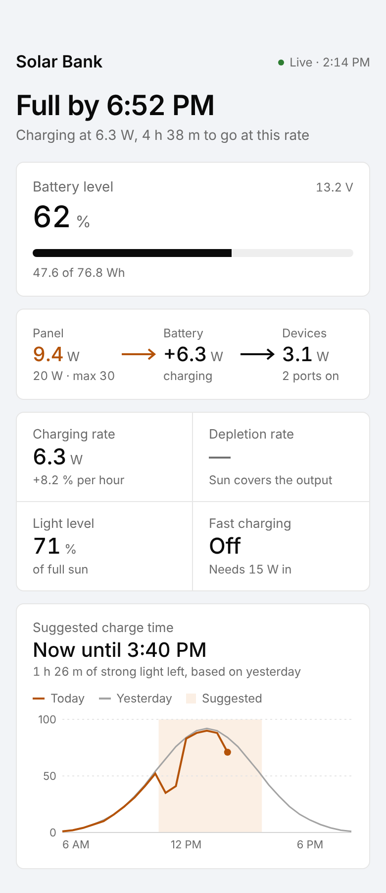
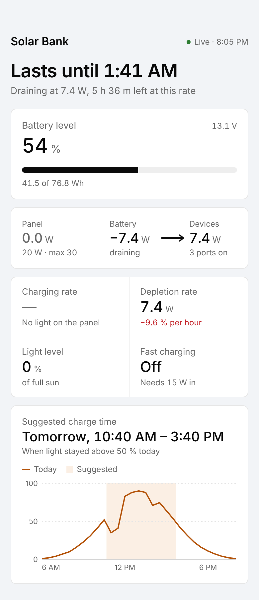
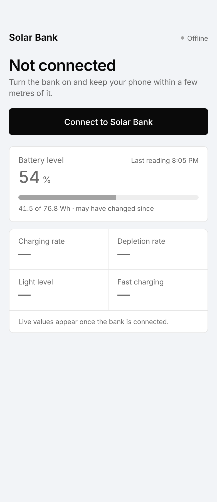

# Solar Bank — Software

UCI EECS 159A/B senior design. A modular solar power bank with swappable panels. The bank sends
live battery/solar data over Bluetooth to a phone app that answers one question:
**"Is my power bank charging, and how long until it's full (or empty)?"**

| Charging | Draining | Not connected |
| --- | --- | --- |
|  |  |  |

``` bash
modular-solar-charger/
├── firmware/
│   └── esp32/           ESP32-H4 code (C, ESP-IDF): reads sensors, sends data over Bluetooth
│       └── main/
│           ├── main.c            starts everything, sends data 5x/second
│           ├── telemetry.h       ★ the data packet (must match the app)
│           ├── sensors.c/.h      sensor readings — FAKE data for now, TODOs for hardware
│           └── ble_telemetry.c/.h  Bluetooth server
├── app/                 Phone app (React Native + Expo, TypeScript) — iOS and Android
│   ├── App.tsx                   loads fonts, renders Home
│   └── src/
│       ├── config.ts             battery size, thresholds, efficiency (change here)
│       ├── theme.ts              colours, type, spacing
│       ├── protocol/telemetry.ts ★ decodes the data packet (must match firmware)
│       ├── protocol/stats.ts     battery %, watts, time-to-full, suggested charge time
│       ├── ble/bankConnection.ts real Bluetooth connection
│       ├── ble/mockConnection.ts fake bank with scenarios, for building UI with no hardware
│       ├── storage/lightHistory.ts  saves light samples + last battery reading on the phone
│       ├── hooks/useBank.ts      connection + smoothing + stale detection
│       ├── components/           Header, Headline, BatteryCard, PowerFlow, RatesGrid, SuggestionCard
│       └── screens/Home.tsx      picks the state and lays out the cards
├── docs/protocol.md     ★ byte-by-byte description of the packet
├── docs/ui/             UI mockups
└── .vscode/             shared editor settings + recommended extensions
```

★ = these three must always agree. Change one → change all three.

## Who works where

| Team | Folder |
| --- | --- |
| App / UI / stats | `app/` |
| Bluetooth firmware | `firmware/esp32/main/ble_telemetry.c` |
| Sensors / hardware | `firmware/esp32/main/sensors.c` |

## Setup (one time)

1. Install **VS Code**, **Git**, and **Node.js LTS**.
2. Open this folder in VS Code → accept the "install recommended extensions" popup.
3. ESP32: run **ESP-IDF: Configure ESP-IDF Extension** from the command palette (Ctrl/Cmd+Shift+P) → Express install.
4. App: `cd app && npm install`.

## Run the app

Everything below runs inside `app/`.

| Goal | How | Needs |
| --- | --- | --- |
| Work on UI with fake data | `npm run start:mock` → scan the QR code with **Expo Go** | Any phone, any computer |
| Work on UI in a browser | `npm run web` | Any computer |
| Real Bluetooth, Android | `npm run android` (first build ~5–10 min), then `npm start` | Android Studio (SDK), phone on USB with USB debugging. Windows/Linux/Mac all fine |
| Real Bluetooth, Android, no Android Studio | `npx eas-cli build --profile development --platform android` → install the APK, then `npm start` | Free Expo account |
| Real Bluetooth, iPhone, with a Mac | `npm run ios` (builds a dev client), then `npm start` | Mac + Xcode, iPhone on USB, free Apple ID (re-sign every 7 days) |
| Real Bluetooth, iPhone, **no Mac** | `npx eas-cli device:create` (register the iPhone once), then `npx eas-cli build --profile development --platform ios` → install from the link, then `npm start` | Free Expo account + **paid Apple Developer account** ($99/yr — one per team is enough; ask UCI first) |

Expo Go **cannot** use Bluetooth. Without the BLE module (Expo Go, web) the app runs on mock data automatically.

**Dev menu:** long-press the "Solar Bank" title to switch mock data on/off, pick a scenario
(`charging`, `draining`, `balanced`, `stale`, `overRating`), or disconnect to see the "Not connected" screen.
Each scenario sets the mock clock to the mockup's time (e.g. charging starts at 2:14 PM).

**Suggested charge time** comes from the free [Open-Meteo](https://open-meteo.com) solar forecast
(`app/src/weather/forecast.ts`, no API key). It needs the phone's rough location: the card shows
"Use my location for a sun forecast" until the user allows it. Without location or internet, it
falls back to the light history the app saved while connected. Mock mode uses a made-up forecast.

> The mockups assume no charger losses (9.4 W in = 6.3 W + 3.1 W out). The app uses η = 0.90 from
> `config.ts`, so in the running mock "Full by" lands later than the mockup's 6:52 PM. The unit tests
> check the mockup numbers with η = 1.

## Checks (run before every PR)

```bash
cd app
npm run typecheck
npm test
```

## Run the firmware

In VS Code, bottom status bar: set target **esp32h4** → select the USB port → **Build, Flash and Monitor** (flame icon).
Then check it in the **nRF Connect** phone app: you should see `SolarBank` advertising.
With fake data on, the bank runs through one fake "day" (sunrise → sunset → night) every 2 minutes.

## Bring-up order

1. App with mock data → build the UI (no hardware needed).
2. Flash ESP32 (fake data) → see `SolarBank` in nRF Connect, values changing.
3. App with real Bluetooth → same screen, real (fake) packets from the ESP32.
4. Hardware team replaces fake data in `sensors.c` with real readings.
